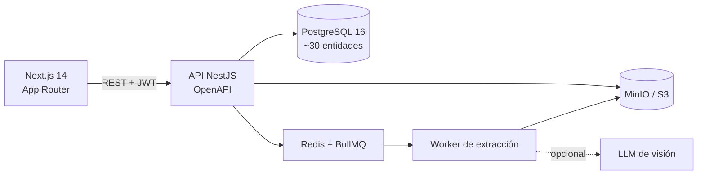

# FugaCero

**SaaS B2B de auditoría financiera y asistencia contable con IA: lee comprobantes, detecta errores y duplicados, y concilia contra el banco.**

-C72E49?logo=minio&logoColor=white)

> 🇬🇧 **English summary.** Multi-tenant B2B SaaS for accounting firms and SMBs in Argentina. Users upload invoices
> and receipts (PDF, images, CSV, Excel or a ZIP with hundreds of files); an async pipeline extracts the data
> deterministically and, for scans, through a vision LLM whose output is schema-validated and re-parsed. A rule engine
> flags duplicates, duplicate payments and arithmetic errors; a bank reconciliation engine matches statements to
> documents (1:1, 1:N, N:1, fees and withholdings). Built with NestJS, Prisma, PostgreSQL, BullMQ, MinIO and Next.js,
> fully dockerized. Phases 1–4 of 8 built and tested end to end. Source code is private.

---

## El problema

Las pymes y los estudios contables pierden plata en errores que nadie ve: facturas cargadas dos veces,
pagos duplicados, neto + IVA que no da el total, movimientos del banco sin comprobante. Revisarlo a mano
es lento. FugaCero lo revisa automáticamente y deja **indicios** para que un profesional decida
(no reemplaza al contador matriculado).

## Qué hace hoy

| Fase | Contenido | Estado |
|---|---|---|
| 1 | Fundaciones: monorepo, auth, MFA, organizaciones, RBAC, multi-tenant | ✅ |
| 2 | Documentos: carga, almacenamiento S3, extracción, OCR con IA, carga masiva por ZIP | ✅ |
| 3 | Motor de auditoría: reglas, hallazgos, workflow de revisión | ✅ |
| 4 | Conciliación bancaria + reglas que cruzan banco y comprobantes | ✅ |
| 5 | IA conversacional con herramientas permisionadas y citas | ⏳ |
| 6 | Portal para estudios contables y reportes | ⏳ |
| 7 | Comercialización: planes, Mercado Pago, onboarding | ⏳ |
| 8 | Producción: hardening, E2E, backups, monitoreo | ⏳ |

### Extracción de documentos
- Cola **BullMQ** con worker asíncrono (concurrencia 3); hash SHA-256 y **detección de duplicado exacto** al subir.
- Extracción **determinística** primero: CSV con parser propio (preserva ceros a la izquierda y fechas),
  Excel, PDF con heurísticas argentinas (CUIT con dígito verificador, punto de venta y número, neto / IVA / total).
- **OCR con IA de visión** para imágenes y PDFs escaneados (Messages API). La salida se **valida contra un esquema
  estricto** y los importes se re-parsean con las mismas utilidades determinísticas. Sin API key, el documento
  queda pendiente: nunca se inventan datos ni se llama a un servicio externo.
- Corrección manual con **historial versionado** de cada campo.

### Motor de auditoría
- Reglas como **funciones puras y testeadas**: duplicados, pagos duplicados, neto + IVA ≠ total,
  movimiento sin comprobante, factura sin pago, pago sin factura.
- Hallazgos **idempotentes** (fingerprint de evidencia): re-ejecutar no multiplica resultados.
- Workflow de revisión con transiciones validadas e historial.

### Conciliación bancaria
- Importación de extractos CSV/Excel con detección de columnas y deduplicación.
- Motor de matching puro: 1:1, parcial por comisión o retención, **1:N y N:1 por subset-sum acotado**.
  Todo queda como sugerencia hasta que una persona lo confirma.

## Arquitectura

- **Monolito modular**, no microservicios innecesarios; `apps/api` y `apps/web` con Dockerfile multi-stage.
- Importes en `Decimal(18,2)`, nunca float.
- URLs firmadas de S3 para descarga directa desde el navegador.

## Seguridad

- **Argon2id**, access JWT de 15 min + **refresh opaco rotativo y revocable** (hash en base), **MFA TOTP**.
- **Aislamiento multi-tenant centralizado** (`AccessService`): el tenant nunca sale del cliente; probado con tests.
- Superadmin sin acceso a datos financieros salvo con un permiso de soporte con alcance, vencimiento y auditoría.
- `ValidationPipe` con whitelist estricta, rate limiting global, Helmet, CORS restringido, audit log.
- Diseñado para la Ley 25.326 de protección de datos personales.

## Calidad

Tests unitarios de las reglas de auditoría y del motor de matching; cada fase se valida end to end
con datos sintéticos antes de cerrarla.

## Mi rol

Diseño de producto, arquitectura, backend, frontend, IA e infraestructura.

---

Código privado (producto en desarrollo de Anhur Dynamics). Este repositorio documenta el producto y su arquitectura.
